  

# 🌐 Awesome System Status & Uptime Monitoring

  
  
  
  
  
  

> 🚀 **A curated directory of top System Status and Uptime Monitoring platforms** — covering both commercial SaaS solutions and powerful self-hosted, open-source alternatives for monitoring website availability, tracking uptime SLAs, sending incident notifications, and communicating service health to customers.

---

## 📑 Table of Contents

- [📈 Sector Overview & Market Dynamics](#-sector-overview--market-dynamics)
- [🟦 SaaS / Hosted Platforms](#-saas--hosted-platforms)
- [🟩 Open-Source Software](#-open-source-software)
  - [1. Uptime Kuma](#1-uptime-kuma-)
  - [2. Upptime](#2-upptime-)
  - [3. Cachet](#3-cachet-)
  - [4. Gatus](#4-gatus-)
  - [5. Checkmate](#5-checkmate-)
  - [6. OpenStatus](#6-openstatus-)
  - [7. OneUptime](#7-oneuptime-)
  - [8. Kener](#8-kener-)
  - [9. cState](#9-cstate-)
  - [10. Cloudflare Workers Status Page](#10-cloudflare-workers-status-page-)
  - [11. StatPing.ng](#11-statpingng-)
  - [12. Kuvasz Uptime](#12-kuvasz-uptime-)
- [📊 Feature Comparison at a Glance](#-feature-comparison-at-a-glance)
- [🤝 Contributing](#-contributing)
- [💖 Support](#-support)
- [⭐ Star History](#-star-history)
- [📄 License](#-license)

---

## 📈 Sector Overview & Market Dynamics

The dedicated status page and uptime monitoring software sector represents an estimated **$400M–$500M market**, expanding rapidly at a **~12.5% CAGR** towards an overarching **$7.5B+ broader server, synthetic, and digital experience monitoring market**. Rather than an extreme winner-take-all monopoly, the sector exhibits **moderate fragmentation**: high-end enterprise procurement heavily consolidates around legacy incumbents like Atlassian Statuspage and Freshworks, while mid-market teams, independent developers, and privacy-conscious organizations drive surging demand for agile all-in-one alternatives (like Better Stack) and rich self-hosted open-source solutions.

---

## 🟦 SaaS / Hosted Platforms

Commercial, cloud-hosted System Status and Uptime Monitoring platforms, sorted in descending order by company size (valuation / annual revenue).

| 🏢 Platform | 💰 Company Size (Valuation / Revenue) | 🏷️ Starting Paid Price | 🎁 Free Tier / Trial Limit | 💡 Key Focus & Strengths | ⚠️ Primary Trade-offs |
|---|---|---|---|---|---|
| **Atlassian Statuspage** | ~$40B–$55B market cap / ~$4.4B–$5.2B ARR | $29/mo (Hobby plan) | **Free forever plan**: Up to 100 subscribers, 2 team members, 2 metrics, 25 components, email & Slack/Teams notifications | Industry-standard incumbent with deep integrations (Datadog, New Relic, PagerDuty, Jira, Slack). Built-in incident workflows and subscriber management. | High pricing at scale; subscriber notifications paywalled on low tiers; SAML SSO enterprise-only. |
| **Freshstatus** (Freshworks) | ~$3.5B–$4.5B market cap / ~$720M–$840M ARR | $19/agent/mo (Freshservice Starter; legacy was $0) | **Free forever plan**: Up to 250 subscribers, unlimited services/components, custom domain support, email & Slack alerts | Deep native integration into the Freshworks ecosystem (Freshdesk/Freshservice); generous free tier allowances. | Standalone product transitioned into Freshservice suite; limited standalone monitoring depth. |
| **Better Stack** | ~$93M valuation / ~$3.8M ARR | $29/mo (Team plan) | **Free forever plan**: 1 status page (custom domain & dark mode), 10 uptime monitors (3-min checks), 10 heartbeats, email & Slack alerts | Bundles uptime monitoring, on-call scheduling, log management, and status pages into one cohesive vendor. Sub-30s checks on paid plans. | High-volume log storage (>100GB/mo) gets pricey; enterprise procurement sometimes requires Atlassian specifically. |
| **StatusCast** | ~$1.1M estimated ARR (Acquired by 4me / Xurrent) | $39/mo (Starter plan) | **14-day free trial**: Full access to status page features, multi-channel alerts, and ITSM integrations (no credit card required) | Specializes in employee-facing internal IT status pages, enterprise ITSM integrations, and audience segmentation. | Geared primarily toward internal corporate IT rather than public developer-facing status pages. |
| **Statuspal** | ~$550K estimated ARR | $46/mo (Hobby plan) | **14-day free trial**: Up to 10 monitored services, 5 team members, 500 subscribers, full public status page features | Advanced subscriber management, multi-language pages, granular audience segmentation, and cost-effective SMB pricing. | Smaller third-party monitoring integration catalog; lean team with narrower feature scope than enterprise suites. |
| **Instatus** | ~$297K estimated ARR | $20/mo (Pro plan) | **Free forever plan**: Up to 200 email subscribers, 15 monitors (2-min checks), 5 team members, 2 on-call members (`instatus.com` domain) | Extremely fast page load speeds (sub-100ms first paint), clean modern UI, affordable custom domain upgrade at $20/mo. | Smaller integration ecosystem; lacks deep enterprise governance and complex incident workflows. |
| **Hund** | Bootstrapped / Profitable (<$1M ARR) | $29/mo (20 components base) | **30-day free trial**: Full access to component dependency modeling, watchdog monitoring, and status page features (no credit card required) | Deep component hierarchy (groups, regions, sub-components, nested dependencies) and granular state machines for 50+ services. | Lower brand recognition; minimal growth marketing; overkill for simple services (<10 components). |

---

## 🟩 Open-Source Software

Self-hosted, community-driven System Status and Uptime Monitoring tools, sorted in **descending order by GitHub Stars_Count**.

### 1. Uptime Kuma 
- **Repository:** [louislam/uptime-kuma](https://github.com/louislam/uptime-kuma)
- **Stack:** 🟢 Node.js / Vue.js / SQLite | **License:** MIT
- **Overview:** Uptime Kuma is the most widely-used self-hosted uptime monitor in the world, frequently described as an open-source UptimeRobot alternative. It supports HTTP(s), TCP, Ping, DNS, Keyword, Steam Game Server, and Docker container monitoring.
- **Key Features:** **78+ notification providers** (Telegram, Discord, Slack, Webhook, Pushover, Email, etc.), multi-language UI, ping charts, certificate expiry tracking, MFA/2FA, and built-in incident status pages.
- **Trade-off:** Focused on monitoring checks; its status page layout is clean but lacks complex multi-stage incident management workflows.
- **Best For:** Developers and homelabbers seeking an easy-to-deploy, modern uptime monitor with extensive alerting.

---

### 2. Upptime 
- **Repository:** [upptime/upptime](https://github.com/upptime/upptime)
- **Stack:** 🐙 GitHub Actions / Svelte / Markdown | **License:** MIT
- **Overview:** An open-source uptime monitor and status page powered entirely by GitHub Actions, GitHub Issues, and GitHub Pages. It requires zero server setup and zero hosting maintenance.
- **Key Features:** Runs automated cron checks every 5 minutes using GitHub Actions, records response time history in git commits, uses GitHub Issues for incident postmortems, and automatically builds a static status page hosted on GitHub Pages.
- **Trade-off:** Subject to GitHub Actions rate limits and scheduling jitter; minimum check interval is capped around 5 minutes.
- **Best For:** Open-source projects and small SaaS teams who want a 100% free, serverless, maintenance-free status page.

---

### 3. Cachet 
- **Repository:** [cachethq/cachet](https://github.com/cachethq/cachet)
- **Stack:** 🐘 PHP / Laravel / MySQL / PostgreSQL / SQLite | **License:** BSD-3-Clause (v2) / SSPL (v3)
- **Overview:** Cachet is one of the classic, battle-tested open-source status page systems built for organizations wanting a traditional customer-facing portal.
- **Key Features:** Granular service components, scheduled maintenance management, multi-step incident reporting (Investigating, Identified, Watching, Fixed), two-factor authentication (2FA), and comprehensive REST API.
- **Trade-off:** Version 2.x maintenance has slowed down, while the v3 rewrite is ongoing with custom licensing. Does not feature extensive native automated monitoring out of the box (primarily fed via external checks or APIs).
- **Best For:** PHP/Laravel environments needing a standalone incident communication portal.

---

### 4. Gatus 
- **Repository:** [TwiN/gatus](https://github.com/TwiN/gatus)
- **Stack:** 🔵 Go / SQLite or PostgreSQL / Prometheus | **License:** Apache-2.0
- **Overview:** Gatus is a lightweight, developer-first automated health dashboard configured entirely through a declarative YAML configuration file.
- **Key Features:** Monitors HTTP, ICMP, TCP, DNS, GraphQL, and TLS certificate expiration. Exports Prometheus metrics, integrates with 20+ notification channels (Slack, Discord, Teams, PagerDuty), and consumes negligible system memory (~10MB RAM at idle).
- **Trade-off:** No web-based configuration UI (GitOps/YAML only); does not feature manual incident scheduling or subscriber email newsletters.
- **Best For:** DevOps and SRE teams wanting a GitOps-native, code-reviewed monitoring system with Prometheus export.

---

### 5. Checkmate 
- **Repository:** [bluewave-labs/Checkmate](https://github.com/bluewave-labs/Checkmate)
- **Stack:** ⚡ Node.js / TypeScript / React / Docker | **License:** AGPL-3.0
- **Overview:** Checkmate is a modern, self-hosted tool designed to track and monitor server hardware, website uptime, response times, and incidents in real time with sleek visualizations.
- **Key Features:** Server hardware stats (CPU, RAM, Disk) combined with uptime monitoring, interactive incident tracking, fast dashboard UI, and rich notification integrations.
- **Trade-off:** Newer project compared to long-standing tools; rapid ongoing development cycle.
- **Best For:** Teams wanting combined server infrastructure health metrics and uptime monitoring in one unified dashboard.

---

### 6. OpenStatus 
- **Repository:** [openstatusHQ/openstatus](https://github.com/openstatusHQ/openstatus)
- **Stack:** ⚛️ Next.js / TypeScript / Tailwind CSS / Tinybird | **License:** AGPL-3.0
- **Overview:** OpenStatus is a modern, open-source status page, incident management, and synthetic uptime monitoring platform built for indie creators and modern engineering teams.
- **Key Features:** Multi-region synthetic monitoring probes (via global Edge locations), beautiful public/private status pages, incident timeline creation, and subscriber notifications via email and RSS feeds.
- **Trade-off:** Self-hosting the full distributed stack requires multiple moving parts (Next.js, database, analytics engine); also provides a managed cloud tier.
- **Best For:** Open-source teams wanting a cutting-edge aesthetic with global multi-region response time checks.

---

### 7. OneUptime 
- **Repository:** [oneuptime/oneuptime](https://github.com/oneuptime/oneuptime)
- **Stack:** 🐳 TypeScript / Node.js / Docker / Kubernetes | **License:** Open Source (Fair Source / Business Source)
- **Overview:** OneUptime is an all-in-one open-source observability suite designed as a comprehensive replacement for Datadog, PagerDuty, and Statuspage combined.
- **Key Features:** Bundles uptime monitoring, status pages, on-call alert scheduling with escalation policies, incident management, telemetry logs, and APM tracing into a unified enterprise platform.
- **Trade-off:** Resource-heavy deployment requiring Docker Compose or Kubernetes; overkill for simple single-server setups.
- **Best For:** Platform engineering teams wanting to self-host their entire incident and observability lifecycle.

---

### 8. Kener 
- **Repository:** [rajnandan1/kener](https://github.com/rajnandan1/kener)
- **Stack:** 🔶 SvelteKit / Node.js / SQLite or PostgreSQL | **License:** MIT
- **Overview:** Kener is a sleek, batteries-included open-source status page with native incident lifecycle management and automated uptime monitoring.
- **Key Features:** 11 active monitoring check types, maintenance windows with RRULE recurring support, incident timeline tracking, RBAC admin dashboard, multi-language i18n, embeddable status widgets, and subscriber notifications.
- **Trade-off:** Community is smaller than Uptime Kuma; active monitoring configurations are tied to its status page structure.
- **Best For:** Organizations looking for an out-of-the-box, balanced status page with integrated active monitoring and incident workflows.

---

### 9. cState 
- **Repository:** [cstate/cstate](https://github.com/cstate/cstate)
- **Stack:** 🦫 Hugo / Static Site Generator / Go | **License:** MIT
- **Overview:** cState is an ultra-fast, static, serverless status page theme built on Hugo. It uses minimal HTML, CSS, and vanilla JS with zero server runtimes required.
- **Key Features:** Sub-second load times, Netlify/GitHub Pages/Vercel zero-cost deployment, CMS support (Decap/Netlify CMS), read-only JSON API, and custom status badge generation.
- **Trade-off:** Purely an incident communication page with no automated background monitoring engine (incidents are published via markdown files).
- **Best For:** Engineering teams that already monitor systems via third-party alerts and require a resilient, serverless status page that stays online even when their core infrastructure is down.

---

### 10. Cloudflare Workers Status Page 
- **Repository:** [eidam/cf-workers-status-page](https://github.com/eidam/cf-workers-status-page)
- **Stack:** ☁️ Cloudflare Workers / KV Storage / CRON Triggers | **License:** MIT
- **Overview:** A completely serverless status page and monitoring solution deployed globally on Cloudflare’s edge network using Cloudflare Workers, KV, and CRON Triggers.
- **Key Features:** Automatic multi-location uptime checks via CRON triggers, daily operational history, zero server maintenance, Slack/Discord/Telegram incident alerts, and low latency worldwide.
- **Trade-off:** Tied specifically to the Cloudflare Workers ecosystem; historical metrics are limited by Cloudflare KV write frequencies.
- **Best For:** Cloudflare users seeking a fast, zero-server-cost uptime status page.

---

### 11. StatPing.ng 
- **Repository:** [statping-ng/statping-ng](https://github.com/statping-ng/statping-ng)
- **Stack:** 🐹 Go / Docker / SQLite or PostgreSQL | **License:** GPL-3.0
- **Overview:** A community-maintained drop-in fork of the original Statping project, providing an all-in-one Go binary combining active HTTP/TCP monitoring with an interactive status page.
- **Key Features:** Built-in mobile-friendly status page, interactive charts, notification handlers (Slack, Discord, Twilio, Webhooks), and custom plugins.
- **Trade-off:** Smaller maintainer team compared to primary active projects; legacy codebase architecture.
- **Best For:** Users familiar with Statping looking for single-binary self-hosted simplicity.

---

### 12. Kuvasz Uptime 
- **Repository:** [kuvasz-uptime/kuvasz](https://github.com/kuvasz-uptime/kuvasz)
- **Stack:** ☕ Kotlin / Micronaut / Docker | **License:** Open Source
- **Overview:** Kuvasz is a performant, API-first uptime and SSL certificate monitor equipped with brandable status pages, Infrastructure-as-Code support, and Prometheus metrics export.
- **Key Features:** Multi-channel alerting (Slack, Discord, Telegram, PagerDuty, MS Teams), OpenTelemetry & Prometheus telemetry, maintenance window definitions, and an MCP (Model Context Protocol) server for AI assistant integration.
- **Trade-off:** Emerging project with a smaller ecosystem and user base.
- **Best For:** Java/Kotlin shops and platform teams requiring an API-driven monitor with native MCP support.

---

## 📊 Feature Comparison at a Glance

| 🛠️ Platform | 📜 License | 🗂️ Architecture Type | 🔍 Uptime Monitoring | 📢 Status Page | 🚨 Incident Mgmt | 🖥️ Self-Hosted | 🎯 Ideal Use Case |
|---|---|---|:---:|:---:|:---:|:---:|---|
| **Atlassian Statuspage** | Proprietary | Commercial SaaS | 🔌 Integrations | ✅ | ✅ | ❌ | High-budget enterprise procurement |
| **Freshstatus** | Proprietary | Commercial SaaS | 🔌 Freshservice | ✅ | ✅ | ❌ | Freshworks suite integration |
| **Better Stack** | Proprietary | Commercial SaaS | ✅ Built-in | ✅ | ✅ On-call | ❌ | Indie/mid-market bundled monitoring |
| **StatusCast** | Proprietary | Commercial SaaS | 🔌 Integrations | ✅ | ✅ | ❌ | Enterprise internal employee IT status |
| **Statuspal** | Proprietary | Commercial SaaS | 🔌 Integrations | ✅ | ✅ | ❌ | Advanced multi-language subscriber alerts |
| **Instatus** | Proprietary | Commercial SaaS | ✅ Built-in | ✅ | ✅ | ❌ | High-speed, affordable Statuspage alternative |
| **Hund** | Proprietary | Commercial SaaS | ✅ Built-in | ✅ | ✅ | ❌ | Complex multi-component architectures (50+ services) |
| **Uptime Kuma** | MIT | Open Source | ✅ Built-in | ✅ Basic | ❌ | ✅ | Most popular self-hosted monitor |
| **Upptime** | MIT | Open Source / Serverless | ✅ GitHub Actions | ✅ | ✅ Issues | ✅ (GitHub) | Zero-maintenance, free status page |
| **Cachet** | BSD/SSPL | Open Source | 🔌 Basic / Manual | ✅ | ✅ | ✅ | Traditional PHP/Laravel status portal |
| **Gatus** | Apache-2.0 | Open Source | ✅ Built-in | ✅ Basic | ❌ | ✅ | GitOps-driven YAML monitoring & Prometheus |
| **Checkmate** | AGPL-3.0 | Open Source | ✅ Built-in | ✅ | ✅ | ✅ | Server hardware stats + uptime monitoring |
| **OpenStatus** | AGPL-3.0 | Open Source | ✅ Edge Synthetic | ✅ | ✅ | ✅ | Modern Next.js stack with global probes |
| **OneUptime** | Open Source | Open Source | ✅ Full APM | ✅ | ✅ On-call | ✅ | Kubernetes platform teams (Datadog/PagerDuty alt) |
| **Kener** | MIT | Open Source | ✅ Built-in | ✅ | ✅ | ✅ | Balanced out-of-the-box status page |
| **cState** | MIT | Open Source / Static | ❌ Manual | ✅ | 📝 Markdown | ✅ (Static) | Static Hugo serverless communication page |
| **Cloudflare Workers** | MIT | Open Source / Edge | ✅ Cron Trigger | ✅ | 📝 KV History | ✅ (Cloudflare) | Serverless edge status page on Cloudflare |
| **StatPing.ng** | GPL-3.0 | Open Source | ✅ Built-in | ✅ | ✅ | ✅ | Single Go binary deployment |
| **Kuvasz Uptime** | Open Source | Open Source | ✅ Built-in | ✅ | 🗓️ Maintenance | ✅ | API-driven Kotlin monitor with MCP server |

---

## 🤝 Contributing

Contributions are warmly welcomed! If you know of a stellar open-source status page or uptime monitoring tool that should be featured:

1. 🍴 Fork this repository.
2. 🌿 Create a feature branch: `git checkout -b feat/add-new-tool`.
3. 📝 Add the project details (name, GitHub repo URL, Stars_Badge, tech stack, license, and stand-out capabilities).
4. 🚀 Open a Pull Request with a clear description!

---

## 💖 Support

If this curated collection saved you time or helped you build a more reliable infrastructure, please consider showing your support:

- ⭐ **Star this repository** to help others discover it!
- 🍴 **Fork and share** it with your engineering and DevOps team.
- ☕ **Buy me a coffee & support ongoing maintenance** via the [Sponsor Dashboard](https://github.com/sponsors/ishandutta2007).

Your support keeps this guide fresh, accurate, and actively updated! 🙏✨

---

## ⭐ Star History

---

## 📄 License

This repository and curated list are released under the [Creative Commons Zero v1.0 Universal (CC0 1.0)](https://creativecommons.org/publicdomain/zero/1.0/) Public Domain Dedication. All listed software products, logos, and platforms remain the property and copyright of their respective owners.
